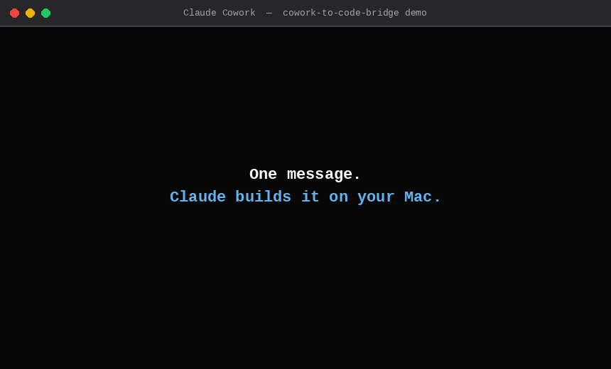

# Contributing

Thanks for your interest. This is a small, single-author project; PRs and issues
are welcome and triaged best-effort.

## New here?

Here's what you're contributing to — one message in a Claude chat, and a real
Claude Code agent scaffolds, installs, runs, and verifies an app on the machine:

<p align="center">
  
</p>

Start with a [good first issue →](https://github.com/abhinaykrupa/cowork-to-code-bridge/issues?q=is%3Aissue+is%3Aopen+label%3A%22good+first+issue%22).

Want to re-cut that clip, or record a terminal-only asciinema version? The exact
shot list lives in [`docs/demo-recording-script.md`](docs/demo-recording-script.md)
— docs/media contribution, no code required.

## Ground rules

- **Platforms:** macOS (launchd), Linux (`systemd --user` when available, or
  the [manual no-systemd path](docs/LINUX-NO-SYSTEMD.md) for containers/minimal
  distros), and WSL2 (systemd inside Ubuntu). Native Windows (Task Scheduler) is
  not implemented yet — open an issue before a large Windows-only PR.
- **No new runtime dependencies.** The client and daemon are deliberately pure
  Python standard library. Keep them dependency-free.
- **Don't break the safety model.** The daemon must only run whitelisted scripts,
  must keep the token check, and must not open a network listener.
- **Keep crash-resilience intact.** Don't change the result-write → journal →
  inflight-clear → queue-move ordering in `daemon.py` without understanding the
  recovery logic (see `docs/architecture.md`).

## Dev setup

```bash
git clone https://github.com/abhinaykrupa/cowork-to-code-bridge
cd cowork-to-code-bridge
make venv && make hooks               # .venv with pytest + ruff, pre-push hook
```

## Running checks

Checks run **locally** — GitHub Actions only builds and publishes releases
(`publish.yml`). The `Makefile` is the entry point:

```bash
make venv          # one-time: create .venv (Python >= 3.10) + dev extras
make check         # ruff + shell syntax + shell tests + pytest + selfcheck --smoke
make e2e           # real install.sh/uninstaller in clean Docker containers (skips if Docker is down)
make brew-audit    # brew audit --strict on the formula (skips if brew is missing)
make check-matrix  # pytest on every installed Python 3.10/3.11/3.12
make hooks         # once per clone: enable .githooks/pre-push (runs `make check`)
```

The Makefile uses `.venv/bin/python` when it exists. Individual pieces:
`make test`, `make lint`, `make shell-check`, `make shell-tests`, `make selfcheck`.

With the hook enabled, every `git push` runs `make check` first. In a hurry:
`git push --no-verify` skips it. PRs should keep `make check` green; run
`make e2e` when touching `install.sh`, the uninstaller, or the hardened layout,
and `make brew-audit` when touching `packaging/homebrew/`.

## Two copies of the client — keep them in sync

There are intentionally two copies of the client:

- `cowork_to_code_bridge/client.py` — the importable package version.
- `bridge_client.py` (repo root) + `skill/cowork-to-code-bridge/bridge_client.py`
  — the single-file, stdlib-only copy that ships inside the global skill.

`tests/test_single_file_client.py` guards that the single-file copy stays
stdlib-only and that its `call_remote` / `call_remote_streaming` signatures match
the package. If you change the client API, update **all** copies and the guard
test will keep you honest. Same for `daemon/daemon.py`, which mirrors
`cowork_to_code_bridge/daemon.py`.

## Commit / PR conventions

- Conventional-ish prefixes (`feat:`, `fix:`, `docs:`) are appreciated.
- Describe *what changed and why*; note anything you verified manually.
- Bump the version in `pyproject.toml`, `.claude-plugin/plugin.json`, and the
  client `__version__` together for releases, and add a `CHANGELOG.md` entry.

## Security

If you find a security issue (e.g. a way to escape the script whitelist or bypass
the token), please open a private report rather than a public issue.
